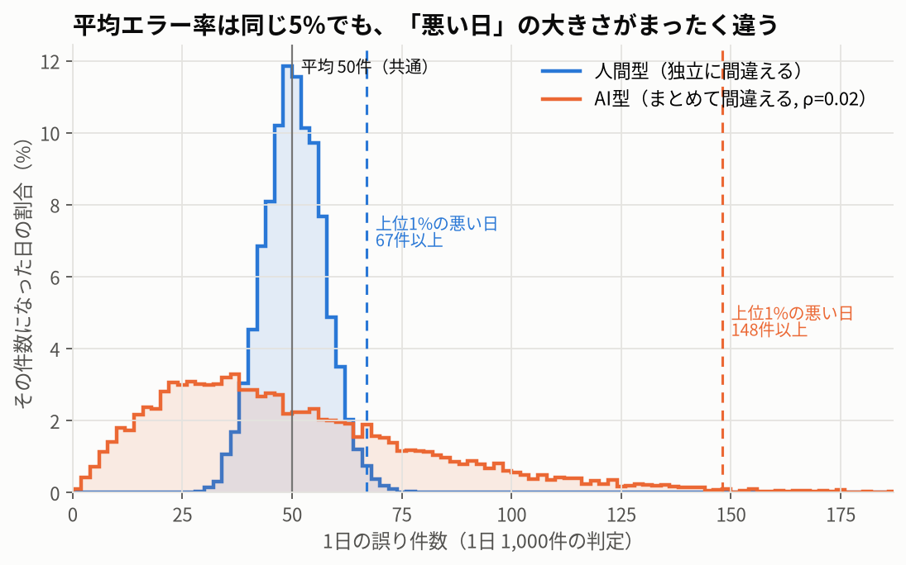
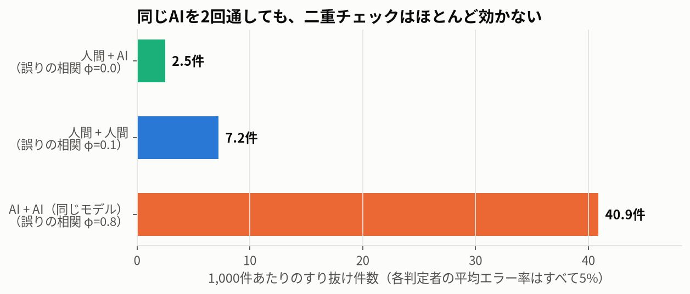
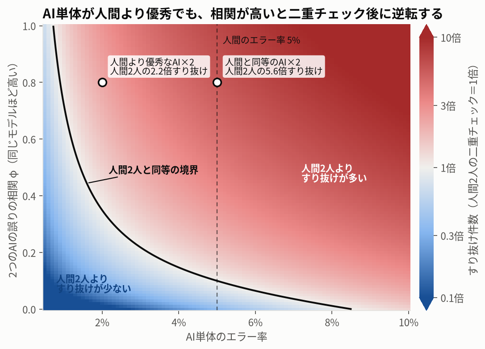

# 実験01：誤りの相関シミュレーション

**問い**：平均エラー率が同じでも、間違え方（誤りの相関）が違えば、リスクと最適なチェック体制は変わるか。

**答え**：変わる。平均が同じ5%でも、AI型（誤りがまとまる）は「悪い日」が人間型の約2.2倍の大きさになり、
同じモデルのAIを2つ重ねた二重チェックは、人間2人の約5.7倍の誤りをすり抜けさせる。

> すべてのパラメータは仮定であり、実データから推定したものではありません。
> 示しているのは「間違え方が違うと何が起きるか」という傾向で、数値そのものではありません。

## 再現方法

```bash
docker compose run --rm sim    # 図とCSVを results/ に出力（数秒）
docker compose run --rm test   # テスト
```

乱数 seed は `config.yaml` で固定しているので、何度実行しても同じ図・同じ数値になります。

## モデル

1日 1,000件の判定を 10,000日分シミュレーションします。どの判定者も平均エラー率は5%です。

- **人間型（独立誤り）**：各件が5%で独立に誤る。1日の誤り件数は二項分布。
- **AI型（相関誤り）**：入力の構成によって、その日のエラー率自体がゆらぐ。日次エラー率を平均5%のベータ分布から引き、
  1日の誤り件数はベータ二項分布になる。ゆらぎの大きさを級内相関 ρ で表す（ρ=0 なら人間型と同じ）。
- **2人の判定者の相関 φ**：2人目は、各件について確率 φ で1人目と同じ結果を写し、残りは独立に引き直す。
  平均エラー率を保ったまま、同じ日の中での誤りの相関がちょうど φ になる（`tests/test_judges.py` で確認）。
- **二重チェック**：2人の判定が食い違えば見直して正しく処理する。残る誤り（すり抜け）は「2人とも誤った件」だけ。

## 結果

### A：単独判定 ― 平均は同じでも、悪い日の大きさが違う



| 判定者 | ρ | 1日の誤り件数の中央値 | 上位1%の悪い日 | 最悪の日 | 人間型の「上位1%」を超える日の割合 |
| --- | --- | --- | --- | --- | --- |
| 人間型 | 0 | 50件 | 67件 | 78件 | 0.7% |
| AI型 | 0.005 | 48件 | 94件 | 135件 | 14.8% |
| AI型 | 0.02 | 43件 | 148件 | 235件 | 24.2% |
| AI型 | 0.05 | 35件 | 233件 | 430件 | 26.6% |

AI型は「ふだんの日」はむしろ人間型より誤りが少ない（中央値43件）。一方で、まとめて間違える日があり、
上位1%の悪い日は148件と人間型の約2.2倍になる。人間型にとって100日に1度の悪い日の水準を、
AI型は4日に1度ほど超える。「AIはだいたい優秀なのに、たまにひどく外す」という印象は、この形から生まれる。

### B：二重チェック ― 同じAIを2回通しても、ほとんど効かない



| 組み合わせ | 誤りの相関 φ | 1,000件あたりのすり抜け | 悪い日（上位1%）のすり抜け |
| --- | --- | --- | --- |
| 人間 + AI | 0.0 | 2.5件 | 10件 |
| 人間 + 人間 | 0.1 | 7.2件 | 14件 |
| AI + AI（同じモデル） | 0.8 | 40.9件 | 122件 |

同じモデルのAI同士は同じ所で間違えるので、二重にしても5%の誤りのうち約8割がそのまま残る。
人間同士にも同じ研修・同じ思い込みによる弱い相関（φ=0.1）を置いたため、間違える所がずれている「人間 + AI」が最も効く。

**感度**（`results/b_sensitivity.csv`）：人間同士の相関を φ=0 にすると、「人間 + 人間」と「人間 + AI」はどちらも2.5件で並ぶ。
「人間 + AI が最も良い」という結果は、人間同士にも共通の盲点があるという仮定に依存している。

### C：感度分析 ― AI単体が人間より優秀でも、組み合わせ後に逆転する



人間2人（エラー率5%、φ=0.1）の二重チェックを基準1倍として、AIを2つ重ねたときのすり抜けを比べた。
境界線より右上では、AI×2のほうが多くすり抜ける。

| AI単体のエラー率 | 人間2人と同等になる AI同士の相関 φ |
| --- | --- |
| 1% | 0.72 |
| 2% | 0.35 |
| 3% | 0.22 |
| 5% | 0.10 |

エラー率2%と人間より優秀なAIでも、2つのAIの誤りの相関が0.35を超えると、人間2人の二重チェックに負ける。
同じモデルを2回通す（φ=0.8）と、人間2人の約2.2倍すり抜ける。
この図は理論式 φq + (1−φ)q² から描き、`results/c_validation.csv` でシミュレーションとの一致を確認している。

## 設計への示唆

- AIは「平均エラー率」ではなく、**悪い日の大きさ**（上位パーセンタイル）と**誤りの偏り**（どの入力で間違えるか）で評価する。
- 二重チェックの価値は、2者が**違う所で間違える**ことから生まれる。同じモデルの再実行や、同じプロンプトの別サンプルでは代わりにならない。
- 人間同士のダブルチェックにも共通の盲点がある。AIを組み合わせることで、それを崩せる余地がある。

## 限界

- パラメータ（p=5%、ρ、φ）はすべて仮定。現実の値は業務とモデルによって大きく異なる。
- 人間の誤りも、疲労・繁忙・同じ思い込みによって日をまたいで相関しうる。ここでは人間型の ρ を0に置いた。
  `config.yaml` の `rho_values` や `human_pair_phi` を変えれば、その場合も試せる。
- 二重チェックで食い違いが出れば必ず正しく処理される、と仮定している。実際には確認者自身も見逃す（自動化バイアス）。これは第2回で扱う。
- 判定は二値（正しい／誤り）。多クラスの判定では、2者が「別々の誤答」を出して食い違いとして検出される場合がある。

## 出力ファイル

| ファイル | 内容 |
| --- | --- |
| `results/a_daily_errors.png` / `a_summary.csv` | 実験A：日次誤り件数の分布と要約 |
| `results/b_double_check.png` / `b_summary.csv` | 実験B：組み合わせごとのすり抜け |
| `results/b_sensitivity.csv` | 実験B：人間同士の相関を変えた感度 |
| `results/c_heatmap.png` / `c_break_even.csv` | 実験C：感度分析と、人間2人と同等になる境界 |
| `results/c_validation.csv` | 実験C：理論値とシミュレーションの照合 |
